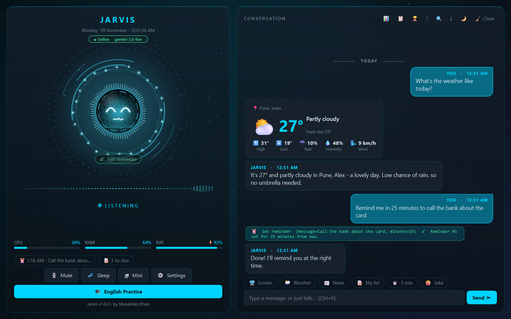
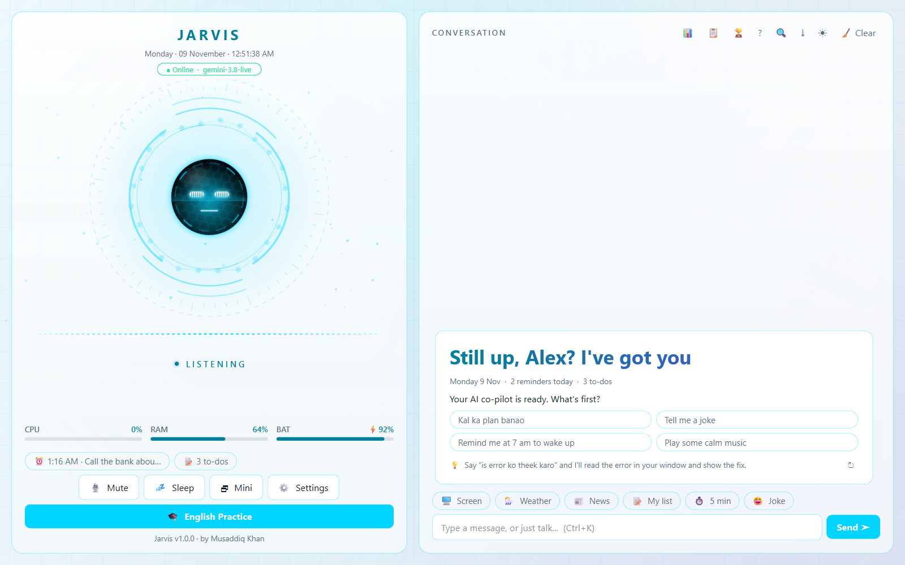
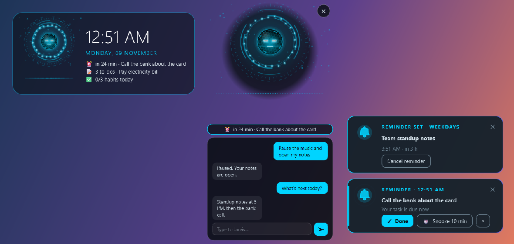
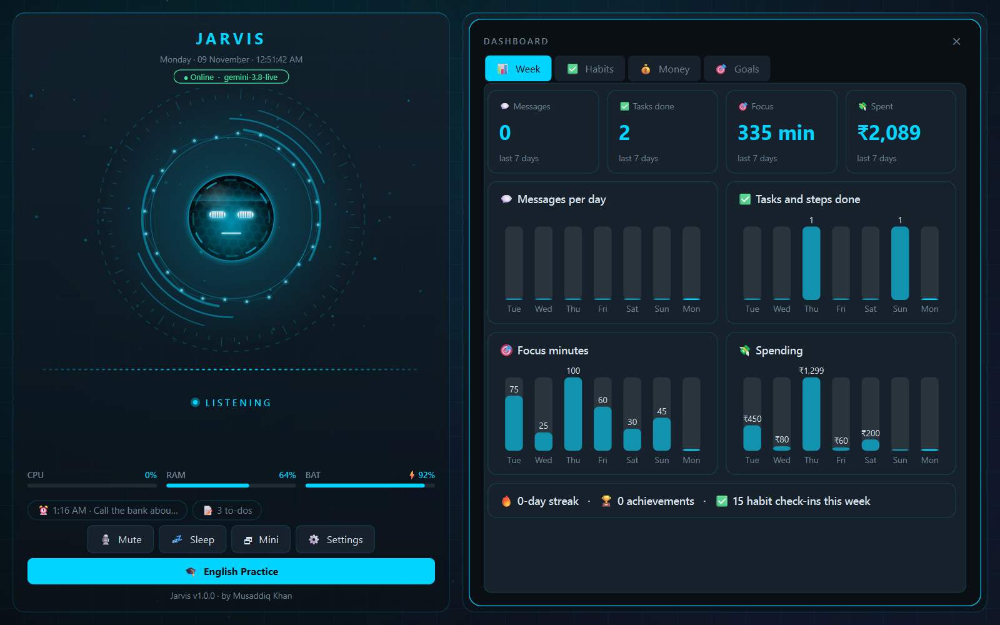
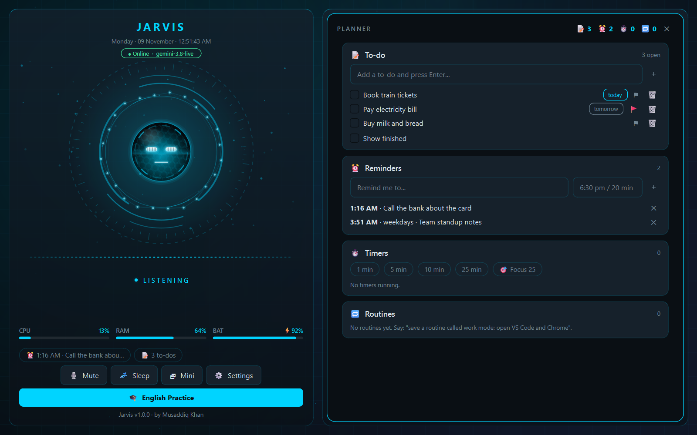
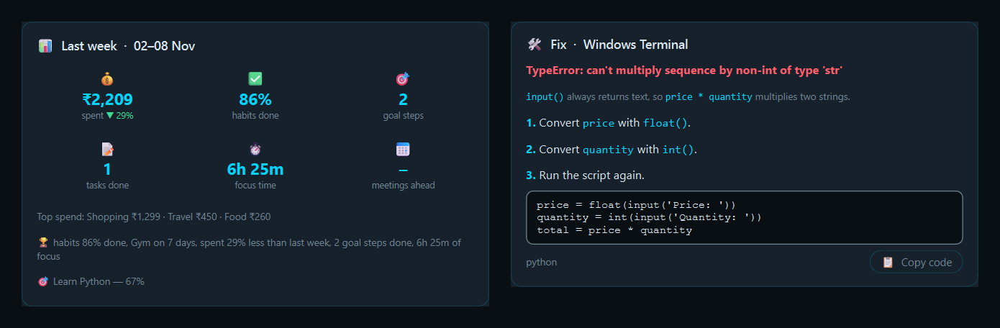

<div align="center">

# ◉ JARVIS

### Your real-time voice AI assistant for Windows

Talk to your PC like a person. Jarvis listens, answers out loud and gets things done.




</div>

---

## ✨ Highlights

| | |
|---|---|
| 🎙️ **Natural voice** | Low-latency, two-way conversation on the Gemini Live API. Say its name to wake it, interrupt it, or just type. |
| 🌐 **Your language** | English, Hindi, Urdu, Hinglish and 10 more. Pick one for Jarvis and another for reminders, or let it follow you. |
| 🖥️ **Runs your PC** | Opens and closes apps and tabs, volume, brightness, media, WiFi, windows, keyboard, files and WhatsApp. |
| 👁️ **Sees your screen** | Reads what is on screen and turns an error into a fix card: the problem, the cause, the steps and the corrected code. |
| ⏰ **Never forgets** | Reminders that pop up at the side of the screen with Done / Snooze, timers, smart to-dos with deadlines and priorities, and calendar sync with meeting alerts. |
| 📊 **Knows your week** | Expenses, habits, goals, focus time and a weekly report card, plus a dashboard with charts. |
| 📄 **Reads your documents** | Finds files by what is inside them and answers questions about any PDF, Word, Excel or PowerPoint file, with page numbers. |
| 🕹️ **Moves on command** | Moves, resizes and minimizes its own window by voice, and scrolls the page you are reading until you say stop. |
| 🪟 **Always within reach** | A floating mini mode with its own chat, a live widget on your wallpaper and a global hotkey. |
| 🏠 **Smart home** | Lights, plugs, fans and the AC through Home Assistant or Tuya / Smart Life (Wipro, Syska, Havells ...), on your home WiFi. |
| 📱 **From your phone** | Message your own Telegram bot (text or voice notes). Only your account is obeyed, and risky actions ask Yes / No. |
| 🎨 **Make it yours** | Robot, cat, anime or minimal avatars, colours taken from your wallpaper, and pop-ups on the screen you are using. |
| 📴 **Works offline** | No internet? Timers, reminders, notes, apps and volume still work, answered in the built-in Windows voice. |
| 🎓 **Language coach** | A separate practice mode with a daily plan, quizzes, role-plays, pronunciation tips and progress tracking. |
| 🛡️ **Private by design** | Cards, OTPs, passwords and keys are never sent or saved. The API key is encrypted, and backups never include it. |

---

## 📸 A closer look

<table>
<tr>
<td width="50%"><br><sub><b>A new welcome on every start</b>. The greeting fits the time of day, with a tip and suggestions.</sub></td>
<td width="50%"><br><sub><b>Desktop widget, mini chat and reminder pop-ups</b>, even when the window is minimized.</sub></td>
</tr>
<tr>
<td><br><sub><b>Dashboard</b>: messages, tasks, focus and spending at a glance.</sub></td>
<td><br><sub><b>Planner</b>: to-dos with deadlines and importance, reminders, timers and routines.</sub></td>
</tr>
<tr>
<td colspan="2"><br><sub><b>Weekly report</b> and <b>fix-on-screen</b> cards, right in the chat.</sub></td>
</tr>
<tr>
<td colspan="2"><br><sub><b>Power-up wake</b>: say the name and the core charges, bursts and comes online.</sub></td>
</tr>
</table>

---

## 🗣️ Things you can say

| Area | Try |
|---|---|
| Apps & windows | "Open Spotify" · "Close YouTube" · "Put Chrome on the left half" · "Minimize everything" |
| Jarvis itself | "Move to the right corner" · "Keep moving left slowly" … "stop" · "Get smaller" · "Night mode" |
| Screen | "What's on my screen?" · "Fix this error" · "Keep scrolling down" … "stop" · "Take a screenshot" |
| Time | "Remind me in 20 minutes to call mom" · "Every weekday at 9 remind me to stand up" · "5 minute timer" · "Focus for 25 minutes" |
| To-dos | "Add pay the bill by tomorrow, it's urgent" · "What should I do first?" · "Milk is done" |
| Calendar | "What meetings do I have today?" · "When am I free tomorrow?" · "When is my next meeting?" |
| Money & habits | "I spent 450 on a cab" · "How much did I spend this month?" · "Make gym a daily habit" |
| Goals & reports | "Help me learn Python in 3 months" · "Show my weekly report" · "Recap my day" |
| Files & documents | "Find yesterday's PDF that had an invoice" · "What's the total in this document?" |
| Web | "Weather today" · "Top news in two lines" · "Flights from Pune to Delhi next Friday" |
| Messages & code | "WhatsApp mom: I'll be late" · "Write a Python snake game in a folder called snake" |
| Memory & data | "Remember my city is Pune" · "What do you know about me?" · "Back up my data" · "Undo" |
| Language | "Talk to me in Hindi" · "Give reminders in English" |
| Smart home | "Turn on the bedroom light" · "Set the AC to 24" · "Make the lights warm white" · "Turn off all lights" |
| Look | "Become a cat" · "Use my wallpaper's colours" · "Put the desktop widget on" |

Press **F1** in the app to see every example by topic. Click one to try it.

---

## 💿 Install (no Python needed)

1. Download **Jarvis-<version>-windows.zip** from the Releases page and extract it.
2. Double-click **Install Jarvis.cmd**, choose your options and press **Install**.
3. Say **"Jarvis"**. Paste your free [Gemini API key](https://aistudio.google.com/apikey) on first start.

No admin rights are needed. Jarvis installs to `%LOCALAPPDATA%\Programs\Jarvis`, adds Start Menu and desktop shortcuts, and can be removed from **Settings → Apps → Installed apps**. Updating keeps your settings and data.

> **Smart App Control.** Jarvis runs on the official, signed Python runtime from python.org. Some of its libraries (for example parts of Qt) are not code-signed, so on a PC where Windows 11 *Smart App Control* is **On** they can be blocked until they are signed with a certificate. On other PCs, and with Smart App Control off or in evaluation mode, everything works.

Build the package yourself with `python installer/build.py` (it downloads the runtime, checks its signature, self-tests the package and writes the zip to `installer/dist`).

## 🚀 Run from source

**You need:** Windows 10/11, Python 3.10+, a microphone and speakers, and a free [Gemini API key](https://aistudio.google.com/apikey).

```bash
git clone https://github.com/musaddiq-vd/Mini-projects.git
cd Mini-projects/jarvis
python -m venv .venv
.venv\Scripts\activate
pip install -r requirements.txt
python -m jarvis
```

Paste your API key on first start and say **"Jarvis"**. To start without a console window, double-click `jarvis_launcher.pyw`. You can also turn on *Start with Windows* in Settings.

| Shortcut | Action |
|---|---|
| `Ctrl+Alt+J` | Bring Jarvis up from any app |
| `Ctrl+Shift+M` | Mini mode |
| `Ctrl+D` · `Ctrl+P` | Dashboard · Planner |
| `Ctrl+M` · `Ctrl+Space` | Mute · Sleep / wake |
| `F1` | Everything Jarvis can do |

<details>
<summary><b>Other ways to run</b></summary>

```bash
python -m jarvis --cli       # voice in the terminal, no window
python -m jarvis --text      # typed chat in the terminal
python -m jarvis --setup     # set the API key, names and voice in the terminal
python -m jarvis --tools     # list every tool
python -m jarvis --devices   # list microphones and speakers
```

Without headphones, Jarvis mutes your mic while it speaks so it doesn't hear itself. With headphones, turn on *Let me talk over Jarvis* in Settings → Audio.
</details>

---

## 🔒 Privacy & safety

- **Your data stays on your PC** in `~/.jarvis`, never inside the repository. Settings → Privacy shows everything that is kept and deletes any of it.
- **Secrets are guarded.** Card numbers, CVV, OTPs, passwords, PINs, Aadhaar, PAN, bank and passport numbers, API keys and recovery phrases are never sent, never saved, and are masked in history and logs.
- **Encrypted at rest.** The API key and calendar links are encrypted with your Windows account (DPAPI).
- **You stay in control.** Shutting down, deleting and sending messages need your click. Every look at the screen or camera flashes the window.
- **Outside content is only data.** Text from web pages, files, screens and calendar invites is never followed as an instruction.
- **What leaves your PC:** your voice and messages go to Google Gemini, searches go to DuckDuckGo, and weather goes to Open-Meteo. There is no analytics and no tracking.

---

## 🧩 Add your own tool

Drop a file in `plugins/`:

```python
from jarvis.tools import tool

@tool("say_hello", "Greet someone by name.", {"name": {"type": "string"}}, required=["name"])
def say_hello(ctx, name):
    return f"Hello, {name}!"
```

Restart Jarvis and say *"say hello to Ali"*. See [`plugins/_example.py`](plugins/_example.py).

---

## 🗂️ Project layout

```
jarvis/
├── jarvis/
│   ├── live.py          voice session: mic, speaker, tools, vision, reconnect, offline mode
│   ├── app.py           settings, memory, tools, events and the system prompt
│   ├── background.py    briefing, reminders, calendar, nudges, weekly report
│   ├── guardrails.py    secret detection and safety checks
│   ├── tools/           96 tools, one file per area
│   ├── ui/              window, orb, mini mode, widget, pop-ups, cards, dashboard
│   └── english/         the language practice mode
├── installer/           builds the Windows package and its setup window
├── plugins/             your own tools
├── tests/               653 tests
└── docs/                screenshots and the script that makes them
```

## 🧪 Development

```bash
pip install pytest
python -m pytest                    # the full test suite (about a minute)
python docs/make_screenshots.py     # rebuild the README screenshots from demo data
```

---

<div align="center">

**© 2026 Musaddiq Khan** · All rights reserved

</div>
